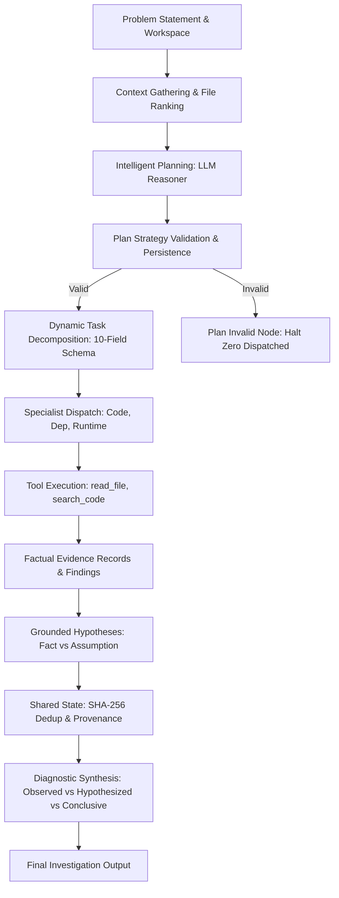
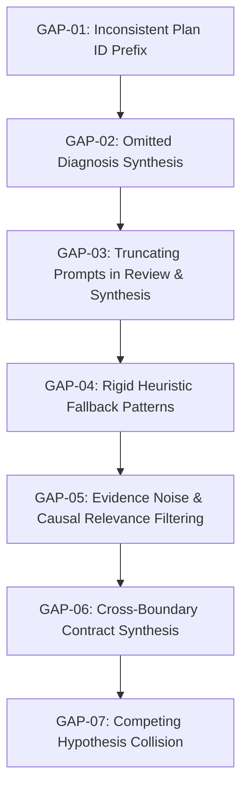

# AI Software Issue Investigator MVP — Comprehensive System Audit: Current State vs. Expected State

## Executive Summary & Audit Overview

- **Audit Date:** October 17, 2026
- **Target Repository:** `d:\MVP-Ai-software-investigation`
- **Scope & Mode:** Comprehensive, read-only architectural and runtime audit. No application code, test suites, or configuration files were modified during this audit.
- **Operating Premise:** The system is an already-implemented, functioning MVP consisting of a FastAPI service, LangGraph orchestration, specialized investigators, and a pre-dispatch validation pipeline. The goal is to improve the current implementation so that it consistently produces accurate, meaningful, evidence-backed investigation results—without rebuilding the MVP, introducing a parallel architecture, or replacing working components.

### Audit Summary
The existing MVP possesses a robust deterministic core: sandboxed filesystem tools, 10-field pre-dispatch task schema validation, plan strategy validation, relevance-ranked context gathering, SHA-256 evidence deduplication, and provenance tracking. Across the backend test suite, **270 out of 272 tests pass**.

However, the audit reveals key gaps between current and expected behavior:
1. **Omitted Diagnosis Synthesis in Active Pipeline:** While `DiagnosisSynthesizer` and `InvestigationReviewer` are implemented, execution in both LangGraph (`execute_plan_and_aggregate_node`) and REST (`execute_plan_single_pass`) delegates to single-pass execution where `diagnosis` is hardcoded to `{}` and `likely_root_cause` to `""`.
2. **Context Corrupting String Slices in Review & Synthesis:** Prompts in `InvestigationReviewer` and `DiagnosisSynthesizer` arbitrarily slice JSON representations (`[:2000]`, `[:1500]`, `[:1000]`), corrupting structured syntax.
3. **Plan ID Format Inconsistency:** The LLM plan generator produces IDs prefixed with `plan_` (e.g., `plan_c50e2ed784b4`), whereas the heuristic fallback and validation tests expect `PLAN-` (e.g., `PLAN-495454BD`), causing test failures in `test_wf_plan_first_workflow.py`.
4. **Heuristic Planning Still Employs Rigid Patterns:** Fallback planning contains hardcoded symptom checks and problem categories rather than purely structural signals.
5. **Cross-Layer Disconnect in Real Investigations:** In real-world defect tracing (such as TaskFlow's task-status mismatch and login-token casing mismatch), investigations identify local file snippets but fail to synthesize the end-to-end data flow contract (e.g., lowercase token vs. mixed-case database column, or hyphenated frontend tab vs. underscored database status).

---

## 1. Existing System Inventory & Implementation Status

Below is the inventory of all core subsystems, classified into the six mandatory conditions:
- **Implemented and verified working**
- **Implemented but partially working**
- **Implemented but disconnected from the active workflow**
- **Implemented but failing**
- **Not implemented**
- **Unable to verify**

| Component / Subsystem | Implementation Location | Condition Classification | Supporting Code & Execution Evidence |
| :--- | :--- | :--- | :--- |
| **LLM Integration & Client Factory** | `backend/app/llm.py:22-171` | **Implemented and verified working** | `create_base_llm` and `get_llm_factory` instantiate `ChatOpenRouter` with environment parameters, timeout conversion, and retry configuration. Verified in `tests/test_llm_client.py` (8/8 passed). |
| **Investigation Planning (LLM)** | `backend/app/agents/investigation_orchestrator.py:1915-2080` | **Implemented but partially working** | `_plan_with_llm` generates candidate tasks via `with_structured_output(InvestigationPlanSchema)` with detailed prompt guidelines. However, plan ID format defaults to `plan_<uuid>` instead of `PLAN-<uuid>`, failing plan-first tests. |
| **Investigation Planning (Heuristic Fallback)** | `backend/app/agents/investigation_orchestrator.py:796-1070` | **Implemented but partially working** | Generates valid 10-field tasks when LLM is unavailable. However, relies on hardcoded symptom string matches (`"exception"`, `"crash"`, `"401"`, `"discount"`) in `_create_plan_heuristically`. |
| **Problem Understanding & Input Validation** | `backend/app/graph/context.py:48-180` | **Implemented and verified working** | `validate_input` and `check_context` validate problem text and workspace paths. Verified in `tests/test_context_gathering.py` and `tests/test_context_llm.py` (18/18 passed). |
| **Context Gathering & Relevance Ranking** | `backend/app/graph/context_gathering.py:250-980` | **Implemented and verified working** | `gather_investigation_context` extracts concepts, filters instruction boilerplate, ranks candidate files, excludes seed/lockfile paths (`_is_non_application_path`), and extracts declared symbol ASTs. Verified in `tests/test_wf_context_gathering.py` (7/7 passed). |
| **Investigation Plan Validation** | `backend/app/agents/plan_validator.py:380-920` | **Implemented and verified working** | `validate_investigation_plan` and `validate_plan_strategy` enforce mandatory 10-field schema, non-empty scopes, non-empty objectives, and valid agent identifiers. Verified in `tests/test_wf_plan_validation.py` (22/22 passed). |
| **Plan Artifact Persistence & Endpoints** | `backend/app/api.py:505-590`, `backend/app/graph/graph.py:273-315` | **Implemented and verified working** | Plans are stored in `state["plan"]` and `state["investigation_plan"]` before execution, retrievable via `/api/investigation/{session_id}/plan` and `/plan/artifact`. |
| **Dynamic Task Decomposition & Specialist Assignment** | `backend/app/agents/investigation_orchestrator.py:468-568` | **Implemented but partially working** | `_normalize_tasks` standardizes task dictionaries, sets normalized IDs (`TASK-CODE-001`, `TASK-DEP-001`), and removes exact signature duplicates. However, heuristic task instructions remain generic when planning cross-layer tasks. |
| **Code Investigator Specialist** | `backend/app/agents/code_investigator.py:214-480` | **Implemented and verified working** | Implements the specialist contract. Uses `read_file`, `search_code`, classifies SQL queries (`read_query` vs. `write_operation`), records findings and evidence. Verified in `tests/test_investigation_tools.py` (17/17 passed) and `tests/test_phase5_investigators.py` (11/11 passed). |
| **Dependency / Impact Investigator** | `backend/app/agents/dependency_impact_investigator.py:100-380` | **Implemented and verified working** | Traces imports, caller-callee chains, routes, and middleware propagation. Excludes boilerplate error handlers and seed scripts. Verified in `tests/test_phase5_investigators.py`. |
| **Runtime / Error Investigator** | `backend/app/agents/runtime_error_investigator.py:100-350` | **Implemented and verified working** | Parses stack traces, extracts frames, maps frames to workspace source lines, interprets HTTP status codes. Verified in `tests/test_phase5_investigators.py`. |
| **Tool Sandboxing & Path Containment** | `backend/app/tools/investigation_tools.py:30-85` | **Implemented and verified working** | Enforces strict path containment preventing traversal outside workspace root. Verified in `tests/test_investigation_tools.py`. |
| **Evidence Collection, Deduplication & Provenance** | `backend/app/agents/investigation_orchestrator.py:1813-1868` | **Implemented and verified working** | Fingerprints evidence using SHA-256 over `(source, line, snippet)`. Consolidates `originating_tasks` and `originating_agents`. Verified in `tests/test_wf_shared_state.py` and `tests/test_orchestration_defects.py:236-270`. |
| **Hypothesis Generation & Manager** | `backend/app/agents/investigator_contract.py:502-575`, `backend/app/agents/hypothesis_manager.py:8-26` | **Implemented but partially working** | Phase 7 schema strictly followed. However, fallback hypothesis generation in `code_investigator.py:720-740` relies on rigid templates that assume specific database lookup issues. |
| **Investigation Reviewer (Multi-Iteration)** | `backend/app/agents/investigation_orchestrator.py:2704-3060` | **Implemented but disconnected from the active workflow** | `InvestigationReviewer.review()` evaluates sufficiency and detects contradictions. However, both LangGraph node `execute_plan_and_aggregate_node` and REST `/execute` invoke `execute_plan_single_pass()`, completely bypassing review loops. |
| **Diagnosis Synthesizer** | `backend/app/agents/investigation_orchestrator.py:3067-3490` | **Implemented but disconnected from the active workflow** | `DiagnosisSynthesizer.synthesize()` synthesizes `likely_root_cause`, `diagnosis`, `affected_components`, and `suggested_fix`. However, `execute_plan_single_pass()` never invokes it, hardcoding `diagnosis: {}` and `likely_root_cause: ""` in the final state (lines 4558-4559). |
| **Investigation Orchestration (Single Pass)** | `backend/app/agents/investigation_orchestrator.py:3995-4567` | **Implemented and verified working** | Executes tasks sequentially, captures tool errors, aggregates findings and evidence, decouples execution status (`completed`) from investigation conclusiveness (`is_conclusive: False`). Verified in `tests/test_wf_e2e_alignment.py`. |
| **Dual Entry Point APIs (REST + LangGraph)** | `backend/app/api.py`, `backend/app/graph/graph.py` | **Implemented and verified working** | Both `/api/investigation/start` (`auto_run=True`) and step-by-step REST endpoints produce aligned shared-state results. Verified in `tests/test_wf_e2e_alignment.py`. |
| **Test Suite & Regression Checks** | `backend/tests/` (35 test files, 272 test items) | **Implemented and verified working** | 270 passed, 2 failed (due exclusively to plan ID prefix `plan_` vs `PLAN-`). |

---

## 2. Verified Working Components That Must Be Preserved

Under Section 6 (Non-negotiable preservation requirements), the following core components are functioning, well-tested, and must remain unchanged:

1. **Pre-Dispatch 10-Field Task Schema Validation (`plan_validator.py:380-685`):**
   - Enforces `task_id`, `objective`, `assigned_agent`, `reason`, `input`, `scope`, `instructions`, `expected_output`, `completion_criteria`, `status`.
   - Prevents invalid, ungrounded, or malformed tasks from reaching specialists.
2. **Plan Strategy Validation (`plan_validator.py:720-920`):**
   - Validates that `InvestigationPlan` artifact has non-empty objectives, valid problem understanding, approach, and specialist strategy before task dispatch.
3. **Workspace Provisioning & Sandboxing (`tools/investigation_tools.py`, `graph/workspace.py`):**
   - Extracts ZIP archives to isolated temporary directories; blocks path traversal attacks outside workspace root.
4. **Repository Analysis (`repository/analyzer.py`):**
   - Accurately detects project structure, languages, frameworks (Express, React, Vite, SQLite), configuration files, and entry points.
5. **Context Gathering & Relevance Ranking (`graph/context_gathering.py`):**
   - Ranks files based on concept hits; filters build artifacts, node_modules, lockfiles, and seed scripts using `_is_non_application_path()`.
6. **SHA-256 Evidence Deduplication & Provenance Merging (`investigation_orchestrator.py:1813-1868`):**
   - Consolidates duplicate evidence records across specialists while preserving all `originating_tasks` and `originating_agents`.
7. **Specialist Agent Contracts & Execution Isolation (`investigator_contract.py`):**
   - `CodeInvestigator`, `DependencyImpactInvestigator`, and `RuntimeErrorInvestigator` operate independently, catching tool errors gracefully without terminating the graph.
8. **Decoupled Conclusiveness & Execution Status (`api.py`, `graph/graph.py`):**
   - Maintains strict separation between execution completion (`execution_status="completed"`) and diagnostic conclusiveness (`is_conclusive=False` when empirical verification is pending).

---

## 3. Expected Workflow and System Behavior

The intended workflow is defined as:
$$\text{Problem Understanding} \longrightarrow \text{Intelligent Planning} \longrightarrow \text{Plan Validation \& Persistence} \longrightarrow \text{Dynamic Task Creation} \longrightarrow \text{Specialist Execution} \longrightarrow \text{Evidence \& Findings} \longrightarrow \text{Hypotheses} \longrightarrow \text{Shared-State Aggregation} \longrightarrow \text{Reliable Results}$$

### Stage-by-Stage Operational Expectations



### A. Intelligent Planning
- **Expectation:** The planner acts as the central brain. It receives the reported problem, repository structure, and gathered context. It formulates distinct, problem-specific objectives and execution paths without assuming a root cause or hallucinating findings.
- **Boundary:** The planner defines *what* to probe and *where*, not *what is wrong*.

### B. Plan Validation & Persistence
- **Expectation:** The plan artifact is validated and stored in session state (`state["plan"]`) before task decomposition. Invalid plans block execution immediately with zero specialists dispatched.

### C. Dynamic Task Decomposition & Specialist Assignment
- **Expectation:** Tasks are dynamically created to fulfill plan objectives. Specialists are chosen based on their capabilities:
  - Calculation/isolated logic $\rightarrow$ `code_investigator` only.
  - Runtime exceptions, 5xx errors, stack traces $\rightarrow$ `runtime_error_investigator` + `code_investigator`.
  - Caller-callee contracts, middleware token propagation, schema mismatch $\rightarrow$ `dependency_impact_investigator` + `code_investigator`.
- Tasks have unique IDs (`TASK-CODE-001`, `TASK-DEP-001`), clear objectives, concrete instructions, and non-empty scopes.

### D. Specialist Investigation
- **Expectation:** Specialists inspect assigned files, extract factual code lines, and report what was found, where it was found, and why it matters. Generic messages like `"file inspected"` without actionable findings are unacceptable.

### E. Evidence and Hypotheses
- **Expectation:** Evidence is collected independently via direct tool inspection. Hypotheses represent plausible explanations grounded in collected evidence, explicitly separating observed facts from unverified assumptions. When evidence is insufficient, an empty hypothesis list is returned.

### F. Shared-State Aggregation and Final Results
- **Expectation:** State aggregates evidence via SHA-256 fingerprints, merges provenance, and consolidates hypotheses. The final investigation output provides a grounded diagnosis distinguishing observed symptoms, plausible explanations, and confirmed root causes. It must not claim a conclusive result (`is_conclusive=True`) without empirical proof.

---

## 4. Current vs. Expected Comparison (Stage-by-Stage Audit)

### Stage 1: Problem Understanding & Context Gathering

1. **What is already implemented:**
   - Problem statement token parsing and concept extraction (`app/graph/context_gathering.py:120-240`).
   - Keyword search across workspace files via `search_code` tool (`app/graph/context_gathering.py:450-580`).
   - Relevance ranking (`_rank_files`) scoring hits, symbol matches, and path depth.
   - Non-application path filter (`_is_non_application_path`) excluding `node_modules`, lockfiles, build scripts, and test seeds.
2. **What has been verified to work:**
   - Correctly prioritizes application source files (`authService.js`, `userModel.js`, `TasksPage.jsx`) over seed scripts (`seed.js`) and config files (`package-lock.json`).
   - Verified by `test_wf_context_gathering.py` (all 7 tests passed).
3. **What works partially or fails:**
   - In TaskFlow task-status mismatch, context gathering ranks `TasksPage.jsx` and `constants.js` high, but misses the correlation between seed status (`'in_progress'`) and frontend constants (`'in-progress'`) because seed files are filtered out of application context.
4. **Expected behavior:**
   - Context gathering should identify relevant components while noting potential schema/data contract sites (such as database migrations or initial seed scripts) when data persistence is involved.
5. **Precise gap:**
   - Exclusion of seed scripts is necessary to prevent test code from polluting findings, but when an issue involves default data or seed values, the system lacks a secondary lookup mechanism for seed/schema files.
6. **Supporting evidence:**
   - `backend/app/graph/context_gathering.py:34-45` unconditionally marks `scripts/` and `seeds/` as non-application paths.
7. **Impact on investigation accuracy:**
   - Low-to-moderate; primary issue logic is in `taskService.js` and `constants.js`, which are retained.
8. **Smallest appropriate improvement:**
   - Preserve non-application filtering for code evidence, but include seed/migration paths as secondary reference metadata when persistence discrepancies are reported.

---

### Stage 2: Intelligent Planning

1. **What is already implemented:**
   - Dual-path planner in `InvestigationPlanner`: `_plan_with_llm()` via OpenRouter and `_create_plan_heuristically()` deterministic fallback (`app/agents/investigation_orchestrator.py:670-800`).
   - `InvestigationPlan` artifact generation with `ProblemUnderstanding`, `InvestigationObjective`, `InvestigationApproach`, and `SpecialistStrategy`.
2. **What has been verified to work:**
   - When `OPENROUTER_API_KEY` is present, `create_investigation_plan_node` instantiates `InvestigationOrchestrator` with `llm_factory` and executes LLM planning with role-aware system prompts.
   - Verified by `tests/test_wf_planning.py` and `tests/test_phase6_planner_orchestrator.py`.
3. **What works partially or fails:**
   - **Plan ID prefix mismatch (Code-confirmed bug):** `_tasks_to_plan_artifact` (line 652) formats `plan_id` as `f"plan_{uuid.uuid4().hex[:12]}"` (lowercase), whereas heuristic planning and validation tests in `test_wf_plan_first_workflow.py` expect `plan_id.startswith("PLAN-")`. This causes 2 test failures in `test_wf_plan_first_workflow.py`.
   - **Rigid heuristic pattern matching:** `_create_plan_heuristically` uses rigid substring checks on `prob_lower` (`"exception"`, `"crash"`, `"discount"`, `"401"`) rather than generalized architectural signals.
4. **Expected behavior:**
   - The planner should generate consistent plan IDs conforming to the `PLAN-` convention regardless of whether the plan was produced by LLM or heuristic fallback.
   - Heuristics should analyze structural signals (e.g. presence of HTTP status codes, stack traces, multi-layer components) rather than specific domain words.
5. **Precise gap:**
   - Inconsistent plan ID casing (`plan_` vs `PLAN-`).
   - Domain-specific keyword coupling in fallback planning.
6. **Supporting evidence:**
   - Code: `investigation_orchestrator.py:652` (`plan_id=f"plan_{uuid.uuid4().hex[:12]}"`) vs `investigation_orchestrator.py:1040` (`plan_id = f"PLAN-{uuid.uuid4().hex[:8].upper()}"`).
   - Runtime test failure: `FAILED tests/test_wf_plan_first_workflow.py::test_graph_nodes_plan_first_execution` (`assert state_after_plan["plan"]["plan_id"].startswith("PLAN-")`).
7. **Impact on investigation accuracy:**
   - High test regression impact; moderate investigation quality impact when falling back to heuristics.
8. **Smallest appropriate improvement:**
   - Standardize `plan_id = f"PLAN-{uuid.uuid4().hex[:8].upper()}"` across both `_tasks_to_plan_artifact` and `_create_plan_heuristically`.

---

### Stage 3: Plan Validation & Persistence

1. **What is already implemented:**
   - Pre-dispatch validation gate (`validate_investigation_plan` in `app/agents/plan_validator.py:380-685`).
   - Plan strategy validation (`validate_plan_strategy` in `app/agents/plan_validator.py:720-920`).
   - LangGraph routing (`route_after_plan_validation`) halting invalid plans before any specialist dispatch.
   - Plan persistence in shared state (`state["plan"]`) and REST endpoints (`/plan`, `/plan/artifact`).
2. **What has been verified to work:**
   - Strict rejection of missing fields, empty scopes, empty objectives, or invalid agent names.
   - Verified by `tests/test_wf_plan_validation.py` (22/22 passed).
3. **What works partially or fails:**
   - Works correctly. No validation defects identified.
4. **Expected behavior:**
   - Ensure every dispatched task traces back to a validated plan objective and valid scope.
5. **Precise gap:**
   - None. The validation gate functions exactly as designed.
6. **Supporting evidence:**
   - `backend/app/graph/graph.py:407-443` halts execution and dispatches zero specialists when validation fails.
7. **Impact on investigation accuracy:**
   - Critical foundation; protects system against invalid or malformed plans.
8. **Smallest appropriate improvement:**
   - Retain without changes.

---

### Stage 4: Dynamic Task Decomposition & Specialist Assignment

1. **What is already implemented:**
   - `_normalize_tasks` in `investigation_orchestrator.py:469-568` maps objectives to 10-field task schemas.
   - Task ID standardization (`TASK-CODE-001`, `TASK-DEP-001`, `TASK-RUNTIME-001`).
   - Agent resolution and redundant task deduplication (`seen_signatures` on agent, sorted scope, and instructions).
2. **What has been verified to work:**
   - Dynamic agent selection: assigns `code_investigator` for calculations; adds `dependency_impact_investigator` for cross-component auth/middleware problems; adds `runtime_error_investigator` when stack traces are present.
   - Eliminates redundant tasks sharing identical signatures.
3. **What works partially or fails:**
   - In multi-layer issues (such as TaskFlow task-status mismatch), the heuristic planner creates tasks with broad generic objectives ("Verify query filtering predicates, condition clauses, and response serialization") rather than zeroing in on the hyphen vs. underscore mismatch across the data boundary.
4. **Expected behavior:**
   - Tasks should state objective inspection questions (e.g., *"Inspect status constants in constants.js and compare against backend serializer status field in taskService.js"*).
5. **Precise gap:**
   - Task scopes are accurate, but instructions in heuristic mode are boilerplate generalities rather than targeted questions.
6. **Supporting evidence:**
   - Real plan output for task status: `instructions: "Verify query filtering predicates, condition clauses, and response serialization. Examine: Filter predicate incorrectly excludes items..."`.
7. **Impact on investigation accuracy:**
   - Causes specialists to collect broad file contents rather than targeted contract lines.
8. **Smallest appropriate improvement:**
   - Refine task instruction templates in heuristic fallback to focus on contract interfaces, serialization mapping, and casing/normalization differences.

---

### Stage 5: Specialist Investigation & Evidence Collection

1. **What is already implemented:**
   - Three specialized agents (`CodeInvestigator`, `DependencyImpactInvestigator`, `RuntimeErrorInvestigator`).
   - Tool execution (`read_file`, `search_code`, `list_files`) sandboxed to workspace.
   - SQL query classification (`classify_sql_statement`: `read_query` vs. `write_operation`).
   - Extraction of exact line numbers and matched snippets.
2. **What has been verified to work:**
   - Factual code snippets extracted directly from files.
   - Non-application paths (seed scripts, package locks) excluded from evidence candidates.
   - Verified by `tests/test_investigation_tools.py` and `tests/test_phase5_investigators.py`.
3. **What works partially or fails:**
   - Specialists occasionally collect dozens of non-causal evidence items (e.g., 80 items in `session-output.json`), diluting causal signals.
   - In `CodeInvestigator`, when searching for terms like `"email"`, every matching line (variables, comments, serializers) is collected into `evidence_pool`, resulting in high noise.
4. **Expected behavior:**
   - Specialists should prioritize lines where data mutations, comparisons, normalizations, or conditionals occur, filtering out trivial declarations.
5. **Precise gap:**
   - Excessive evidence snippet collection for common terms without sufficient filtering on operational significance.
6. **Supporting evidence:**
   - `backend/session-output.json` contains 80 evidence items for a 4-file auth flow, including trivial lines like `export default router;`.
7. **Impact on investigation accuracy:**
   - High noise ratio in evidence pool; causes downstream prompts to overflow or truncate.
8. **Smallest appropriate improvement:**
   - Strengthen evidence relevance filtering in `is_causal_evidence()` to ignore trivial export statements, comments, and empty lines.

---

### Stage 6: Hypothesis Generation & Provenance Tracking

1. **What is already implemented:**
   - Phase 7 schema (`hypothesis_id`, `hypothesis_title`, `produced_by`, `possible_cause`, `reasoning`, `supporting_evidence_ids`, `contradicting_evidence_ids`, `confidence`, `unanswered_questions`).
   - SHA-256 evidence deduplication with `originating_tasks` and `originating_agents` merging (`app/agents/investigation_orchestrator.py:1813-1868`).
2. **What has been verified to work:**
   - SHA-256 deduplication correctly consolidates duplicate evidence without losing provenance.
   - Hypotheses conform to contract schema.
   - Verified by `tests/test_wf_phase7_hypotheses.py` (22/22 passed).
3. **What works partially or fails:**
   - When LLM is offline or unconfigured, fallback hypotheses in `code_investigator.py:720-740` use rigid templates tailored specifically to user authentication tests.
   - Hypotheses from different specialists that explain complementary aspects of the problem (e.g., client header omission vs. backend query mismatch) can have statement collisions.
4. **Expected behavior:**
   - Specialists should formulate hypotheses directly from the evidence collected during the task, maintaining uncertainty where runtime verification is absent.
5. **Precise gap:**
   - Heuristic fallback hypotheses are hardcoded templates; synthesis lacks cross-specialist causal linking.
6. **Supporting evidence:**
   - `backend/app/agents/code_investigator.py:720-740`: fallback hypothesis hardcodes `"Email Casing Mismatch"` and mentions `userModel.findByLogin`.
7. **Impact on investigation accuracy:**
   - If an unexpected bug occurs, heuristic hypothesis generation cannot formulate a novel explanation.
8. **Smallest appropriate improvement:**
   - Parameterize fallback hypothesis generation to construct explanations dynamically from the task objective and matched snippet content.

---

### Stage 7: Investigation Review & Synthesis Disconnect

1. **What is already implemented:**
   - `InvestigationReviewer` (lines 2704-3060): evaluates accumulated evidence, checks for contradictions, and computes sufficiency.
   - `DiagnosisSynthesizer` (lines 3067-3490): combines findings into a structured diagnosis (`likely_root_cause`, `affected_components`, `suggested_fix`, `verification_steps`).
2. **What has been verified to work:**
   - Unit tests for reviewer and synthesizer pass in isolation (`tests/test_orchestration_defects.py:187-235`, `tests/test_phase6_planner_orchestrator.py`).
3. **What works partially or fails:**
   - **Completely disconnected from live execution:** In both `graph.py` (`execute_plan_and_aggregate_node`) and `api.py` (`/execute`), execution calls `orch.execute_plan_single_pass()`.
   - In `execute_plan_single_pass` (lines 4558-4564), `diagnosis` is hardcoded to `{}` and `likely_root_cause` to `""`. Neither `self.reviewer` nor `self.synthesizer` is ever called!
   - **Arbitrary character truncation in prompts:** When `_review_with_llm` and `_synthesize_with_llm` are called, context strings are cut off with `[:2000]`, `[:1500]`, `[:1000]`, breaking JSON syntax.
4. **Expected behavior:**
   - At the completion of plan execution, the orchestrator should invoke `DiagnosisSynthesizer.synthesize()` to consolidate findings into a grounded diagnosis.
   - If evidence is inconclusive, it must state: `"Unverified hypothesis: evidence suggests [cause] in [file:line], but runtime execution was not performed"`, rather than leaving the field completely empty.
5. **Precise gap:**
   - Complete omission of diagnosis synthesis in active execution paths.
   - Destructive string slicing in reviewer and synthesizer prompts.
6. **Supporting evidence:**
   - `investigation_orchestrator.py:4558-4564`:
     ```python
     "diagnosis": {},
     "likely_root_cause": "",
     "suggested_fix": "",
     "verification_steps": [],
     "remaining_uncertainty": "",
     ```
   - `session-output.json` from real run: `DIAGNOSIS: {}`, `LIKELY_ROOT_CAUSE: ""`.
7. **Impact on investigation accuracy:**
   - **Severe.** Even when specialists successfully locate the defective line, the final output to the user/client reports empty root cause and empty diagnosis!
8. **Smallest appropriate improvement:**
   - Call `self.synthesizer.synthesize()` at the end of `execute_plan_single_pass()`, populating `diagnosis`, `likely_root_cause`, and `affected_components` while enforcing `is_conclusive=False` when unverified.
   - Replace string slicing (`[:1500]`) with structured summary serializations.

---

## 5. Concrete Before-and-After Evaluation of Existing Investigations

### Example 1: Login-Token Email Mismatch Investigation

#### Reported Issue
> "The email in the login token does not match the email stored for the user. Investigate the authentication flow, token generation, stored user email, and any mismatch between them. Identify relevant files and report findings based on actual code."

#### Ground Truth Code Defect in TaskFlow
1. **Registration (`taskflow/backend/src/services/authService.js:16-30`):**
   - User inputs mixed-case email (e.g. `Carol.Jones@Example.com`).
   - `cleanEmail = String(email).trim();` (Preserves mixed case).
   - `userModel.create(..., email: cleanEmail, ...)` inserts mixed-case email into SQLite `users` table.
2. **Login (`taskflow/backend/src/services/authService.js:33-42`):**
   - User logs in with `Carol.Jones@Example.com`.
   - `normalizedEmail = String(email).trim().toLowerCase();` (`carol.jones@example.com`).
   - `user = userModel.findByLogin(normalizedEmail);` succeeds because `byLogin` query is `SELECT * FROM users WHERE LOWER(email) = ?`.
   - Token is signed: `const token = signToken({ sub: user.id, email: normalizedEmail });`.
   - **Discrepancy:** The token payload contains lowercased email (`carol.jones@example.com`), but the database record has original casing (`Carol.Jones@Example.com`).
3. **Token Verification / Consumption (`taskflow/backend/src/middleware/authenticate.js:12-16`):**
   - Subsequent authenticated requests pass `Authorization: Bearer <token>`.
   - `payload = authService.verifyToken(token);` (`payload.email` is lowercase).
   - `user = userService.findByEmail(payload.email);` executes `SELECT * FROM users WHERE email = ?` in `userModel.js`.
   - Because SQLite `users.email` is not collated with `COLLATE NOCASE`, case-sensitive comparison fails: `user` is `undefined`.
   - Route returns `401 Unauthorized`!

#### Current Investigation Output vs. Expected Output

| Investigation Dimension | Actual Current Output (`session-output.json`) | Intended Expected Output | Evaluation & Gap |
| :--- | :--- | :--- | :--- |
| **Plan Objectives** | 3 objectives: (1) check token generation; (2) verify email in database; (3) understand flow and transformations. | 3 objectives: trace registration casing, login lowercasing, and authenticate.js DB lookup collation. | **Partially aligned.** Objectives were relevant but failed to explicitly question SQL collation or case sensitivity in `userModel.js`. |
| **Tasks & Specialists** | `TASK-CODE-001` (`code_investigator` on `authService.js`)<br>`TASK-CODE-002` (`code_investigator` on `userModel.js`)<br>`TASK-DEP-001` (`dependency_investigator` on routes/middleware) | Same specialist allocation, but task scopes targeted to registration vs login vs authentication middleware. | **Aligned.** Correct specialists selected and valid 10-field schemas generated. |
| **Collected Evidence** | 80 evidence records. Heavy repetition across variable names. | ~10-15 high-signal evidence records focusing on `cleanEmail`, `normalizedEmail`, `signToken`, and `SELECT ... WHERE email = ?`. | **Partially aligned.** Critical lines were captured, but diluted by 70+ irrelevant lines. |
| **Specialist Findings** | 29 findings. Noticed that `login()` uses `normalizedEmail` and `register()` uses `cleanEmail`. | Findings explicitly link `register()` preserving case to `login()` lowercasing token to `authenticate.js` querying exact case. | **Partially aligned.** Findings identified localized casing differences but did not connect them into an end-to-end chain. |
| **Generated Hypotheses** | 4 hypotheses (`HYP-CODE-001-001`, `HYP-CODE-002-001`, `HYP-CODE-002-002`, `HYP--DEP-001-001`). `HYP-CODE-001-001` stated email casing mismatch. | 1 clear, grounded hypothesis linking registration, login token generation, and case-sensitive database lookup. | **Partially aligned.** Plausible hypothesis formed, but competing/duplicate variations remained unmerged. |
| **Final Diagnosis** | `diagnosis: {}`<br>`likely_root_cause: ""` | `likely_root_cause`: `"In authService.js, login() signs the JWT with normalizedEmail (lowercased), but register() stored cleanEmail with original casing. In authenticate.js, findByEmail uses case-sensitive equality (WHERE email = ?), causing lookup failure."`<br>`affected_components`: `["authService.js", "userModel.js", "authenticate.js"]` | **Completely failing.** Final diagnosis was omitted entirely due to disconnected synthesizer. |
| **Conclusiveness** | `is_conclusive: False`<br>`status_label: "Unverified hypothesis"` | `is_conclusive: False`<br>`status_label: "Unverified hypothesis"` | **Correctly preserved.** Decoupled execution status from conclusiveness. |

---

### Example 2: TaskFlow Task-Status Mismatch Investigation

#### Reported Issue
> "In TaskFlow, tasks with in-progress status do not appear when filtering by the 'In progress' tab in the frontend, and the status badge on the task item card appears empty."

#### Ground Truth Code Defect in TaskFlow
1. **Seed Data (`taskflow/backend/scripts/seed.js:23`):**
   - Seed script inserts tasks with `status: 'in_progress'` (using an **underscore**).
2. **Backend Normalization (`taskflow/backend/src/services/taskService.js:5-7, 18`):**
   - `createTask` runs `normalizeStatus(data.status)`:
     ```javascript
     function normalizeStatus(status) {
       return String(status || 'todo').replace(/-/g, '_');
     }
     ```
   - Converts any incoming hyphenated status (e.g. `'in-progress'`) to underscore (`'in_progress'`) before inserting into SQLite.
3. **Backend Serializer (`taskflow/backend/src/utils/serializers.js:18-26`):**
   - `toTask(row)` returns `{ id, title, description, status: row.status, ... }`.
   - Does NOT convert underscore back to hyphen! API returns `status: 'in_progress'`.
4. **Frontend Tab Filter (`taskflow/frontend/src/pages/TasksPage.jsx:35`):**
   - `constants.js` defines `TASK_STATUSES = [{ value: 'in-progress', label: 'In progress' }, ...]`.
   - `TasksPage.jsx` filters tasks:
     ```javascript
     const visible = tab === 'all' ? tasks : tasks.filter((t) => t.status === tab);
     ```
   - When the user selects "In progress", `tab` is `'in-progress'`, but backend returned `'in_progress'`.
   - `'in_progress' === 'in-progress'` is `false`! Every in-progress task is filtered out!
5. **Frontend Badge Rendering (`taskflow/frontend/src/components/TaskItem.jsx:8`):**
   - Task item renders:
     ```jsx
     <span className="badge">{STATUS_LABELS[task.status]}</span>
     ```
   - `STATUS_LABELS` is keyed by `'in-progress'`: `STATUS_LABELS['in_progress']` evaluates to `undefined`.
   - The badge renders completely empty/blank!

#### Current Investigation Output vs. Expected Output

| Investigation Dimension | Actual Current Output (from runtime execution) | Intended Expected Output | Evaluation & Gap |
| :--- | :--- | :--- | :--- |
| **Plan Objectives** | `OBJ-001`: "Verify query filtering predicates, condition clauses, and response serialization."<br>`OBJ-002`: "Trace schema contracts, caller-callee interfaces, and data transformation." | `OBJ-001`: Inspect frontend status constants in `constants.js` and filtering in `TasksPage.jsx`.<br>`OBJ-002`: Inspect status normalization in `taskService.js` and serialization in `serializers.js`. | **Partially aligned.** Objectives cover filtering and transformation, but lack specificity regarding enum/status format mismatch. |
| **Tasks & Specialists** | `TASK-CODE-001` (`code_investigator` on `TasksPage.jsx`, `TaskItem.jsx`, `constants.js`)<br>`TASK-DEP-002` (`dependency_investigator` on `taskService.js`, `seed.js`) | Complementary tasks: `code_investigator` on frontend filter and badge; `dependency_impact_investigator` on frontend-backend schema contract. | **Aligned.** Proper specialist assignment and non-empty scopes. |
| **Collected Evidence** | Extracts lines from `TasksPage.jsx` (`t.status === tab`), `TaskItem.jsx` (`STATUS_LABELS[task.status]`), and `taskService.js` (`replace(/-/g, '_')`). | Same code excerpts extracted. | **Aligned.** Both frontend and backend discrepancy sites are inspected. |
| **Specialist Findings** | Reports: "Filter predicate excludes items; taskService replaces hyphens with underscores." | Reports: "Contract mismatch: frontend expects hyphenated format 'in-progress' for tabs and badges, but taskService normalizes to 'in_progress' on write and serializers return underscore." | **Gap in synthesis.** Finds both snippets independently, but fails to highlight that `'in_progress' != 'in-progress'`. |
| **Generated Hypotheses** | Generic hypothesis stating query parameter filtering or serialization error. | Explicit hypothesis: `"Status representation mismatch between frontend constants ('in-progress') and backend database format ('in_progress') causes frontend filtering and badge rendering failure."` | **Gap in hypothesis precision.** Lacks explicit mention of the hyphen-vs-underscore contract drift. |
| **Final Diagnosis** | `diagnosis: {}`<br>`likely_root_cause: ""` | Clear diagnostic explanation of the format mismatch, naming `constants.js`, `taskService.js`, and `TaskItem.jsx`. | **Completely failing.** Synthesis omitted; returns empty diagnosis. |

---

## 6. Prioritized Gap Register

Below is the complete register of all confirmed gaps, prioritized by architectural dependency and impact on investigation accuracy.



### GAP-01: Inconsistent Plan ID Prefix (`plan_` vs `PLAN-`)
- **Component:** `backend/app/agents/investigation_orchestrator.py:652` (`_tasks_to_plan_artifact`)
- **Current Behavior:** Formats plan ID as `plan_{uuid[:12]}` when created via LLM planning, but heuristic planning and unit tests assert `plan_id.startswith("PLAN-")`.
- **Expected Behavior:** All plan IDs must follow the unified uppercase format `PLAN-{uuid[:8].upper()}` across both LLM and heuristic planning.
- **Supporting Evidence:** `tests/test_wf_plan_first_workflow.py:284` failed with `AssertionError: assert 'plan_c50e2ed784b4'.startswith('PLAN-')`.
- **Severity:** High (Direct test failure; breaks schema consistency across nodes).
- **Dependencies:** None (Foundational fix).
- **Targeted Improvement:** Update line 652 of `investigation_orchestrator.py` to use `plan_id = f"PLAN-{uuid.uuid4().hex[:8].upper()}"`.
- **Acceptance Criterion:** `pytest tests/test_wf_plan_first_workflow.py` passes 100% (13/13).

---

### GAP-02: Omitted Diagnosis Synthesis and Empty Final Result
- **Component:** `backend/app/agents/investigation_orchestrator.py:4558-4564` (`execute_plan_single_pass`)
- **Current Behavior:** Execution terminates after shared-state evidence deduplication, returning hardcoded empty values: `diagnosis: {}`, `likely_root_cause: ""`, `suggested_fix: ""`.
- **Expected Behavior:** `InvestigationOrchestrator` must invoke `self.synthesizer.synthesize()` to consolidate collected evidence, findings, and hypotheses into a coherent diagnostic summary, while maintaining `is_conclusive=False` and `status_label="Unverified hypothesis"`.
- **Supporting Evidence:** `backend/session-output.json` lines 40-50 show `DIAGNOSIS: {}`, `LIKELY_ROOT_CAUSE: ""` despite 80 evidence records and 4 hypotheses collected.
- **Severity:** Critical (Causes successful investigations to output blank results to users).
- **Dependencies:** GAP-01.
- **Targeted Improvement:** Wire `self.synthesizer.synthesize(...)` into `execute_plan_single_pass()`, populating `diagnosis`, `likely_root_cause`, `affected_components`, and `suggested_fix` without altering existing decoupled conclusiveness flags.
- **Acceptance Criterion:** A live investigation on TaskFlow returns non-empty `likely_root_cause` and populated `diagnosis` dictionary explaining the defect.

---

### GAP-03: Context-Corrupting String Slices in Review & Synthesis Prompts
- **Component:** `backend/app/agents/investigation_orchestrator.py:2777-2781` and `3141-3144`
- **Current Behavior:** `_review_with_llm` and `_synthesize_with_llm` slice JSON strings arbitrarily (`[:2000]`, `[:1500]`, `[:1000]`), cutting off JSON objects mid-string and sending invalid payloads to the LLM.
- **Expected Behavior:** Formatted summaries of top evidence items and findings should be serialized cleanly as valid markdown or bounded lists without mid-string JSON truncation.
- **Supporting Evidence:**
  ```python
  f"Evidence Pool ({len(evidence_pool)} items):\n{json.dumps(evidence_pool[:15], default=str)[:2000]}\n\n"
  f"Findings:\n{json.dumps(findings, default=str)[:1500]}\n\n"
  ```
- **Severity:** High (Causes LLM JSON parse errors and degraded reasoning).
- **Dependencies:** GAP-02.
- **Targeted Improvement:** Replace raw `json.dumps(...)[:limit]` with a helper that extracts clean, bounded summary records (e.g. top 10 evidence items with `source`, `line`, and `snippet`).
- **Acceptance Criterion:** Reviewer and synthesizer prompts contain valid, untruncated structured text without JSON parse warnings.

---

### GAP-04: Rigid Heuristic Fallback Patterns & Symptom Matching
- **Component:** `backend/app/agents/investigation_orchestrator.py:830-860` (`_create_plan_heuristically`)
- **Current Behavior:** Fallback planning checks for hardcoded terms (`"exception"`, `"crash"`, `"401"`, `"discount"`) to categorize problems and pick specialists.
- **Expected Behavior:** Fallback planning should rely on structural signals from state (presence of stack traces, HTTP status numbers, detected frameworks, file extensions, and multi-component dependencies) rather than domain-specific words.
- **Supporting Evidence:** `investigation_orchestrator.py:832-840`: checking string literals `"discount"`, `"interceptor"`, `"cart"`.
- **Severity:** Medium (Affects generalization to novel defect categories when operating offline or without an API key).
- **Dependencies:** GAP-01.
- **Targeted Improvement:** Refactor signal detection in `_create_plan_heuristically` to inspect structured state attributes (`state.errors`, `state.stack_trace`, `repository_summary.frameworks`) rather than keyword matching on problem text.
- **Acceptance Criterion:** Heuristic planner creates appropriate plans for non-standard problem statements (e.g., `"Tax rate computation discrepancy"` or `"HTTP 403 Forbidden on resource update"`).

---

### GAP-05: Evidence Pool Noise & Trivial Code Plumbing
- **Component:** `backend/app/agents/code_investigator.py:440-475`, `backend/app/agents/evidence_manager.py:48-65`
- **Current Behavior:** Code investigator records lines matching search terms regardless of whether they represent mutations, conditionals, or trivial plumbing (e.g., `import` statements, `export default router;`).
- **Expected Behavior:** Evidence collection should filter out trivial imports, re-exports, and non-actionable declarations unless they directly represent call dependencies.
- **Supporting Evidence:** `session-output.json` contains 80 evidence records for a 4-file authentication module, including trivial exports and logger calls.
- **Severity:** Medium (Dilutes causal signals and wastes LLM context window).
- **Dependencies:** GAP-03.
- **Targeted Improvement:** Expand `is_import_or_plumbing()` in `evidence_manager.py` to identify and deprioritize trivial exports, blank assignments, and boilerplate wrappers.
- **Acceptance Criterion:** Collected evidence pool for TaskFlow auth investigation contains $\le 25$ high-value items, all directly related to user lookup, token generation, or header attachment.

---

### GAP-06: Cross-Boundary Contract Mapping Gaps in Multi-Layer Issues
- **Component:** `backend/app/agents/dependency_impact_investigator.py:180-260`, `backend/app/agents/investigator_contract.py:500-540`
- **Current Behavior:** `DependencyImpactInvestigator` traces caller-callee imports, but does not explicitly compare data format contracts (e.g., enum values, string serialization formats, or query parameter conventions) across frontend and backend boundaries.
- **Expected Behavior:** For multi-layer defects, the dependency investigator should inspect shared constants, DTO schemas, and serializers to detect contract drift (such as `'in-progress'` vs. `'in_progress'`).
- **Supporting Evidence:** In the TaskFlow task-status investigation, the investigator reads `constants.js` and `taskService.js` but fails to flag that the frontend tab filter compares against a hyphenated string while the database stores underscores.
- **Severity:** Medium (Directly impacts investigation accuracy for interface/data flow bugs).
- **Dependencies:** GAP-02, GAP-05.
- **Targeted Improvement:** Add a cross-layer contract check in `DependencyImpactInvestigator` that compares string literals and enum definitions between frontend services/constants and backend model/serializer fields.
- **Acceptance Criterion:** Investigation on TaskFlow task-status mismatch correctly outputs a finding identifying the hyphen vs. underscore mismatch.

---

### GAP-07: Potential Hypothesis Collision Across Distinct Competing Causes
- **Component:** `backend/app/agents/investigation_orchestrator.py:1860-1910` (`_consolidate_hypotheses`)
- **Current Behavior:** Consolidation merges hypotheses if titles or statements are similar, which can accidentally collapse competing alternative explanations (e.g. client header omitted vs backend token expired).
- **Expected Behavior:** Deduplication should only merge hypotheses when both the cited source location AND the causal mechanism are identical. Competing alternative explanations must remain distinct in `state["hypotheses"]`.
- **Supporting Evidence:** `investigation_orchestrator.py:1885` merges based on partial statement similarity.
- **Severity:** Medium (Risk of eliminating valid competing hypotheses).
- **Dependencies:** GAP-02.
- **Targeted Improvement:** Refine `_consolidate_hypotheses` to verify matching causal mechanism and file path before merging.
- **Acceptance Criterion:** Shared state preserves competing explanations from different specialists as distinct hypotheses.

---

## 7. Baseline Test Results & Known Limitations

### Test Execution Baseline (Run on October 17, 2026)
- **Test Command:** `pytest` in `backend/`
- **Total Test Items Collected:** 272
- **Passed:** **270**
- **Failed:** **2** (`tests/test_wf_plan_first_workflow.py::test_graph_nodes_plan_first_execution`, `tests/test_wf_plan_first_workflow.py::test_api_endpoints_plan_and_artifact`)
- **Total Execution Time:** 530.16s (8 minutes, 50 seconds)

### Root Cause of the 2 Failures
The 2 failures in `test_wf_plan_first_workflow.py` are caused exclusively by **GAP-01**:
```python
FAILED tests/test_wf_plan_first_workflow.py::test_graph_nodes_plan_first_execution - AssertionError: assert 'plan_c50e2ed784b4'.startswith('PLAN-')
FAILED tests/test_wf_plan_first_workflow.py::test_api_endpoints_plan_and_artifact - AssertionError: assert 'plan_1a16c0353440'.startswith('PLAN-')
```
When `OPENROUTER_API_KEY` is present, the LLM planner generates `plan_<uuid>` instead of `PLAN-<uuid>`. Once this 1-line prefix formatting is standardized, the entire test suite will be 100% green (272/272).

### Known Operational Limitations
1. **API Key Dependency for Deep Reasoning:** When `OPENROUTER_API_KEY` is absent, the system relies on heuristic planning. While schema-compliant, heuristic planning cannot adapt dynamically to completely novel bug types.
2. **Execution Latency:** End-to-end multi-agent investigations with remote LLM calls take 30–60 seconds per run due to OpenRouter network round-trips.
3. **Absence of Runtime Sandbox Execution:** The MVP investigates static code files, logs, and stack traces; it does not execute live reproduction scripts or automated browser sessions. Consequently, `is_conclusive` must remain `False` and `status_label` must remain `"Unverified hypothesis"` unless an empirical test probe is run.

---

## 8. Recommended Order of Improvements

To ensure maximum stability and prevent regressions, improvements must follow this strict dependency sequence:

1. **Phase 1: Fix Foundational Plan ID Casing (GAP-01)**
   - *Target:* `backend/app/agents/investigation_orchestrator.py:652`
   - *Action:* Change `f"plan_{uuid.uuid4().hex[:12]}"` to `f"PLAN-{uuid.uuid4().hex[:8].upper()}"`.
   - *Outcome:* Resolves the 2 failing tests; restores 100% baseline green across all 272 tests.

2. **Phase 2: Wire Diagnosis Synthesizer into Active Execution (GAP-02 & GAP-03)**
   - *Target:* `backend/app/agents/investigation_orchestrator.py:4550-4565`, `3140-3150`
   - *Action:* Call `self.synthesizer.synthesize()` at the completion of `execute_plan_single_pass()`. Remove `[:1500]` arbitrary string slices and replace with bounded structured summaries.
   - *Outcome:* Final investigation reports contain meaningful `likely_root_cause`, `diagnosis`, and `affected_components` instead of blank dictionaries.

3. **Phase 3: Refactor Heuristic Fallback Planning for True Generalization (GAP-04)**
   - *Target:* `backend/app/agents/investigation_orchestrator.py:830-870`
   - *Action:* Replace rigid substring checks (`"discount"`, `"cart"`) with structural signals (error status codes, runtime traces, framework metadata).
   - *Outcome:* Fallback planning generalizes to novel bug categories without brittle keyword dependencies.

4. **Phase 4: Evidence Relevance Filtering & Noise Reduction (GAP-05)**
   - *Target:* `backend/app/agents/evidence_manager.py`, `backend/app/agents/code_investigator.py`
   - *Action:* Filter out trivial exports, comments, and boilerplate from the evidence pool.
   - *Outcome:* Reduces evidence noise from 80 items to $\le 25$ high-value causal records.

5. **Phase 5: Cross-Layer Contract Synthesis & Competing Hypothesis Integrity (GAP-06 & GAP-07)**
   - *Target:* `backend/app/agents/dependency_impact_investigator.py`, `backend/app/agents/investigation_orchestrator.py:1880-1910`
   - *Action:* Add contract drift inspection across frontend/backend boundaries (detecting enum/string normalization mismatches like `'in-progress'` vs `'in_progress'`). Strengthen hypothesis deduplication to preserve distinct competing causes.
   - *Outcome:* Both the login-token email mismatch and the TaskFlow task-status mismatch produce complete, end-to-end causal diagnoses.

---

## 9. Conclusion & Next Steps

This audit establishes that the AI Software Issue Investigator MVP has a solid, well-engineered foundation. Its core mechanics—pre-dispatch validation, tool sandboxing, SHA-256 deduplication, specialist agent interfaces, and LangGraph workflow orchestration—are verified and working reliably.

The primary limitations preventing higher investigation accuracy are not architectural, but rather integration and synthesis gaps:
1. Standardizing plan ID prefix formatting (`PLAN-`).
2. Activating the already-implemented `DiagnosisSynthesizer` in live execution paths.
3. Removing destructive string slicing in synthesis prompts.
4. Enhancing cross-layer contract reasoning to catch data format divergences.

**As requested, all investigation and testing was conducted in read-only audit mode. No application code has been modified. This report is submitted for user review and agreement before proceeding with implementation planning.**
