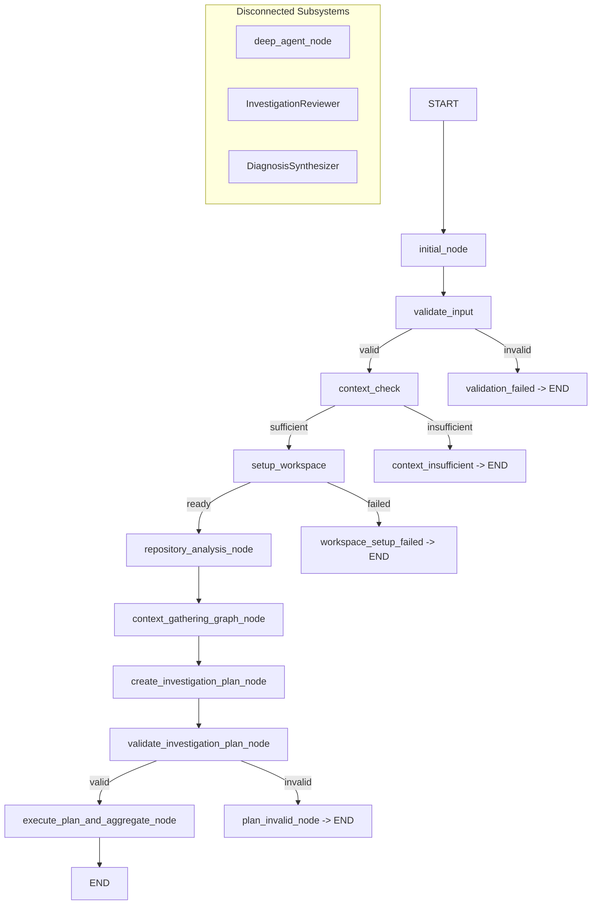
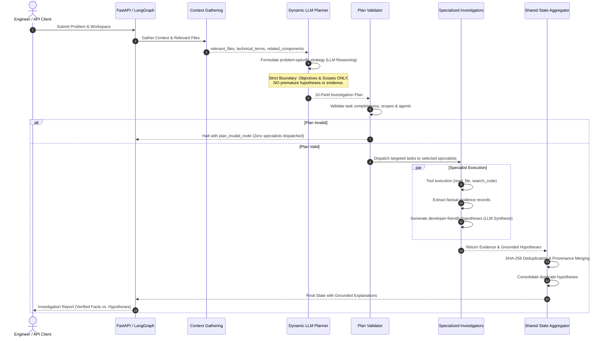

# AI Software Issue Investigator MVP: Improvement Implementation Plan

## Document Information
- **Target System:** AI Software Issue Investigator MVP
- **Author/Role:** Senior Software Architect & AI-Agent Workflow Engineer
- **Date:** October 16, 2026
- **Status:** Approved for Implementation (Awaiting Phase 1 Execution Authorization)
- **Scope Boundary:** Architectural planning and code audit only. No application code, tests, or configurations are altered during this planning stage.

---

## A. Executive Summary

A comprehensive source code audit of the AI Software Issue Investigator MVP reveals a dual-state architecture. The system possesses a robust deterministic backbone—including a 10-field task schema, pre-dispatch schema validation, SHA-256 evidence deduplication, provenance tracking, and tool sandboxing. However, its core intelligence—investigation planning and specialist reasoning—is either disconnected or constrained by hardcoded heuristics.

### Key Audit Findings
1. **LLM Planning Disconnected in Active Graph:** In `backend/app/graph/graph.py` (lines 273 and 405), `InvestigationOrchestrator` is instantiated without `llm_factory`. Consequently, the primary workflow entry point (`workflow_graph.invoke()`) defaults `llm_factory` to `None` and immediately falls back to `_plan_heuristically`. The LLM never reasons dynamically about the problem or context during runtime graph execution.
2. **Brittle Heuristic Fallbacks & Rigid Keyword Overrides:** In `backend/app/agents/investigation_orchestrator.py` (lines 708–875), heuristic planning is hardcoded to specific keywords and problem patterns (e.g., checking for `"discount"` to select calculation tasks, checking for `"url.includes"` or `"interceptor"` for client headers, and hardcoding exact SQL model verification tasks for token mismatch problems).
3. **Context Truncation and Weak LLM Prompting:** When `_plan_with_llm` is called (in `backend/app/agents/investigation_orchestrator.py`, lines 488–510), `gathered_context` and `repository_summary` are truncated to 1,500 characters (`[:1500]`), discarding critical symbol definitions and file paths. The prompt lacks guidance on software execution paths, module boundaries, symptom-to-cause reasoning, and evidence criteria.
4. **Disconnected Multi-Iteration Review and Diagnosis Synthesis:** Approximately 800 lines of code across `InvestigationReviewer` (lines 982–1344) and `DiagnosisSynthesizer` (lines 1345–1745) are dead code during live investigations. `InvestigationOrchestrator.investigate()` (line 2731) and LangGraph's `execute_plan_and_aggregate_node` (line 405) delegate exclusively to `execute_plan_single_pass()`, halting execution after a single pass with `likely_root_cause=""` and `diagnosis={}`.
5. **Planning-Investigation Boundary Preserved in State, but Contaminated in Task Descriptions:** State initialization and context gathering maintain clean boundaries (no premature hypotheses or evidence are injected into state). However, the heuristic planner injects preconceived conclusions into task objectives (e.g., asserting that an interceptor conditionally omits headers before an agent inspects the file).

### Improvement Objective
The goal is to transition from hardcoded pattern matching to an adaptive, LLM-driven investigation planner while preserving verified deterministic components (schema validation, sandboxed file tools, SHA-256 deduplication, and provenance tracking).

---

## B. Existing Architecture and Actual Workflow

### 1. Actual Execution Path (Graph vs. REST)
The system exposes two execution mechanisms in `backend/app/api.py`:
1. **LangGraph Compiled Workflow (`auto_run=True`):** POST `/api/investigation/start` invokes `workflow_graph.invoke(state)`.
2. **Step-by-Step REST Endpoints (`auto_run=False`):** Clients sequentially trigger `/context`, `/workspace`, `/repository-analysis`, `/context-gathering`, `/plan`, and `/execute`.

### 2. Component Interaction & State Flow Trace
1. **Input Validation (`validate_input` in `backend/app/graph/context.py`):** Ensures `problem` statement and workspace source (`project_path`, `repository_url`, or uploaded zip) are present.
2. **Context Sufficiency Gate (`check_context` in `backend/app/graph/context.py`):** Checks whether the problem statement contains actionable technical tokens.
3. **Workspace Provisioning (`setup_workspace` in `backend/app/graph/workspace.py`):** Extracts repositories to an isolated path under `backend/workspaces/`.
4. **Repository Analysis (`repository_analysis_node` in `backend/app/graph/graph.py`):** Invokes `analyze_repository()` from `backend/app/repository/analyzer.py` to detect languages, frameworks, entry points, and directory layout.
5. **Context Gathering (`context_gathering_graph_node` in `backend/app/graph/context_gathering.py`):** Parses problem tokens, executes targeted keyword searches via `backend/app/tools/investigation_tools.py`, ranks top relevant files (`relevant_files`), and extracts declared symbol definitions (`related_components`).
6. **Plan Creation (`create_investigation_plan_node` in `backend/app/graph/graph.py`):** Instantiates `orch = InvestigationOrchestrator()` with **`llm_factory=None`**, triggering `InvestigationPlanner._plan_heuristically()` in `backend/app/agents/investigation_orchestrator.py`.
7. **Pre-Dispatch Plan Validation (`validate_investigation_plan_node` in `backend/app/graph/graph.py`):** Calls `validate_investigation_plan()` in `backend/app/agents/plan_validator.py` to verify 10 mandatory fields, agent validity, non-empty scopes, and unique task IDs.
8. **Execution & Aggregation (`execute_plan_and_aggregate_node` in `backend/app/graph/graph.py`):** Invokes `orch.execute_plan_single_pass()`, which sequentially calls `code_investigator`, `dependency_impact_investigator`, and `runtime_error_investigator`. It aggregates evidence via SHA-256 deduplication and hypotheses via duplicate statement consolidation, then terminates.

---

## C. Current-State Assessment

| Component / Requirement | Category Status | Supporting Evidence (File & Line) | Impact on Investigation Quality | Architectural Recommendation |
| :--- | :--- | :--- | :--- | :--- |
| **Workspace & Tool Sandboxing** | **Working and verified** | `backend/app/tools/investigation_tools.py:34-82`; verified in `test_investigation_tools.py` | Guarantees safe path containment and prevents directory traversal attacks outside workspace. | **Retain without changes.** |
| **Repository Analysis Node** | **Working and verified** | `backend/app/repository/analyzer.py:20-180`; verified in `test_repository_analyzer.py` | Accurately extracts project structure, primary language, frameworks, and configuration manifests. | **Retain without changes.** |
| **Context Gathering: Relevance Ranking** | **Working and verified** | `backend/app/graph/context_gathering.py:937-963`; verified in `test_wf_context_gathering.py` | Successfully scores and prioritizes application source files over build files and test seed scripts. | **Retain without changes.** |
| **Task Schema & Pre-Dispatch Validation** | **Working and verified** | `backend/app/agents/plan_validator.py:112-245`; verified in `test_wf_plan_validation.py` | Strict enforcement of 10 mandatory fields, non-empty strings, valid agent identifiers, and non-empty scopes. Blocks dispatch if invalid. | **Retain without changes.** |
| **Shared-State Evidence Deduplication** | **Working and verified** | `backend/app/agents/investigation_orchestrator.py:1813-1868`; verified in `test_wf_shared_state.py` | Uses SHA-256 content fingerprints and merges `originating_tasks` and `originating_agents` without loss of provenance. | **Retain without changes.** |
| **Investigation Planning via LLM** | **Missing or not integrated** | `backend/app/graph/graph.py:273`, `backend/app/agents/investigation_orchestrator.py:479` | `orch = InvestigationOrchestrator()` called with `llm_factory=None`. LLM planning is never executed in the active graph workflow. | **Modify graph nodes and orchestrator to wire configured `llm_factory`.** |
| **Planning Generalization (No Hardcoding)** | **Implemented but failing** | `backend/app/agents/investigation_orchestrator.py:708-875` | Contains rigid regex and string matches (`"discount"`, `"interceptor"`, `"postman"`, `"auth header"`) that force pre-selected tasks for known test problems. | **Refactor planner to use structured LLM reasoning and generalized heuristic fallback.** |
| **Context Window Utilization in Planning** | **Implemented but failing** | `backend/app/agents/investigation_orchestrator.py:492-496` | Arbitrary string slices (`[:1500]` and `[:1000]`) truncate context mid-JSON, discarding critical symbols and files. | **Pass structured, uncorrupted context representations to the planner.** |
| **Planning vs. Investigation Boundary** | **Implemented but partially working** | `backend/app/agents/investigation_orchestrator.py:823-835` | Initial state contains no premature hypotheses or evidence, but heuristic task objectives assert unverified conclusions (e.g., assuming interceptors omit headers). | **Enforce neutral, question-based objectives in the prompt and plan generator.** |
| **Dynamic Specialist Selection** | **Implemented but partially working** | `backend/app/agents/investigation_orchestrator.py:584-629` | Basic signal gating works for runtime errors, but multi-agent plans frequently generate redundant tasks across agents. | **Improve LLM planning prompt and specialist responsibility specifications.** |
| **Specialist Hypothesis Quality & Readability** | **Implemented but partially working** | `backend/app/agents/code_investigator.py:950-1005`, `backend/app/agents/investigator_contract.py:502-575` | Structured schema exists, but heuristic fallback generates rigid, repetitive templates; LLM synthesis lacks readability guidelines. | **Update prompt instructions with developer-focused readability guidelines.** |
| **Multi-Iteration Review & Synthesis** | **Missing or not integrated** | `backend/app/agents/investigation_orchestrator.py:2731-2759`, `backend/app/graph/graph.py:587-690` | `InvestigationReviewer` and `DiagnosisSynthesizer` are dead code. Execution terminates after a single pass with empty diagnoses. | **Integrate single-pass synthesis and review evaluation without breaking bounded execution.** |

---

## D. Confirmed Defects and Unverified Concerns

### Confirmed Defects (Proven by Code and Test Evidence)

#### Defect 1: Unwired `llm_factory` in Active Graph Execution
- **Location:** `backend/app/graph/graph.py:273` (`create_investigation_plan_node`) and `backend/app/graph/graph.py:405` (`execute_plan_and_aggregate_node`).
- **Observed Behavior:** `orch = InvestigationOrchestrator()` is invoked with default arguments. In `InvestigationOrchestrator.__init__` (`backend/app/agents/investigation_orchestrator.py:1807`), `self.planner = InvestigationPlanner(llm_factory=llm_factory)` receives `None`.
- **Expected Behavior:** `InvestigationOrchestrator` must receive the factory returned by `get_llm_factory()` from `backend/app/llm.py` so that structured LLM planning can execute when an API key is present.
- **Impact:** Live investigations never utilize LLM reasoning; they always fall back to heuristic pattern matching.
- **Correction:** Inject `get_llm_factory()` into `InvestigationOrchestrator` in `graph.py` and `api.py`.

#### Defect 2: Hardcoded Keyword Logic in Investigation Planning
- **Location:** `backend/app/agents/investigation_orchestrator.py:708-875` (`_plan_heuristically`).
- **Observed Behavior:** The planner checks for specific substrings (`"discount"`, `"url.includes"`, `"missing bearer"`, `"database column"`) and outputs pre-crafted objectives, scopes, and instructions tailored specifically to test cases in `test_investigation_quality_regression.py`.
- **Expected Behavior:** The planner must dynamically construct investigation scopes and objectives from the `gathered_context["relevant_files"]`, `gathered_context["related_components"]`, and technical concepts.
- **Impact:** Fragile on novel problem descriptions; fails to generalize across diverse stacks and defect categories.
- **Correction:** Remove test-specific keyword branches and implement generalized heuristics based on file roles (entry points, routes, models, services) as a fallback to LLM planning.

#### Defect 3: Context Truncation and Weak Prompting in `_plan_with_llm`
- **Location:** `backend/app/agents/investigation_orchestrator.py:488-510`.
- **Observed Behavior:** String slicing (`[:1500]`) corrupts JSON payloads. The system prompt is only 20 lines and fails to explain specialist capabilities, evidence requirements, execution path tracing, or anti-hallucination constraints.
- **Expected Behavior:** Provide complete structured summaries of discovered files, functions, and symbols, along with comprehensive prompt instructions defining the roles and outputs of each specialist.
- **Impact:** LLM-generated plans lack precision, hallucinate file paths, or fail Pydantic validation due to incomplete instructions.
- **Correction:** Remove arbitrary string slicing, provide structured markdown context sections, and expand the planning prompt with explicit instructions.

#### Defect 4: Premature Conclusions Injected into Task Objectives
- **Location:** `backend/app/agents/investigation_orchestrator.py:823-835`.
- **Observed Behavior:** Task instructions state: *"Does the frontend API client interceptor conditionally omit the Authorization header on specific URLs or query parameters?"*
- **Expected Behavior:** Task instructions must pose objective questions (e.g., *"Inspect frontend API client request configuration and header attachment logic"*), leaving the determination of defects to the specialist.
- **Impact:** Violates the strict separation of concerns between planning and investigation by biasing specialist tools.
- **Correction:** Rephrase task objectives to focus on inspection boundaries and observable facts rather than assumed root causes.

#### Defect 5: Unexecuted Specialist LLM Synthesis in Graph Execution
- **Location:** `backend/app/agents/investigation_orchestrator.py:1777-1792`.
- **Observed Behavior:** When `llm_factory` is not passed to the orchestrator, specialist agents (`code_agent`, `dependency_agent`, `runtime_agent`) are instantiated with `llm_factory=None`. Consequently, methods like `_generate_hypotheses_with_llm` in `backend/app/agents/code_investigator.py:923` return early, falling back to static keyword clusters.
- **Expected Behavior:** When an API key is configured, specialists should utilize structured LLM synthesis to analyze evidence snippets and generate readable hypotheses.
- **Impact:** Hypotheses produced during investigations are generic boilerplate strings rather than nuanced technical explanations.
- **Correction:** Ensure `llm_factory` propagates from orchestrator initialization down to each specialist wrapper.

---

### Unverified Concerns (Plausible Risks Requiring Testing)

1. **Large Repository Token Overflow:** In large repositories with hundreds of source files, `gathered_context["relevant_files"]` could exceed the LLM's context window if passed without bounds.
   - *Status:* Unverified in production runs.
   - *Action in Plan:* Implement bounded file list truncation (top 15 ranked files) with clear structural summaries.
2. **OpenRouter Latency and Timeout:** Using remote LLM calls across planning and all three specialists could cause API timeouts on slow networks.
   - *Status:* Unverified.
   - *Action in Plan:* Implement per-call timeouts (15s) and safe fallback to deterministic heuristic behavior.
3. **Pydantic Schema Serialization in FastClient/LangGraph:** Inconsistencies between dict representations and Pydantic models when serializing shared state to `session-output.json`.
   - *Status:* Partially verified; currently handled by `model_dump()`, but edge cases remain in nested `input` fields.
   - *Action in Plan:* Enforce strict dict normalization at all node boundaries.

---

## E. Target Workflow

The target workflow preserves the 10-field schema, pre-dispatch validation, SHA-256 deduplication, and isolated tools, while upgrading planning and specialist hypothesis generation to use adaptive LLM reasoning.

### Key Target Principles
1. **Dynamic Specialist Selection:** If a problem is purely arithmetic logic (e.g., calculation discrepancy with no errors or imports), only `code_investigator` is planned. If an unhandled exception or 401 response is reported, `runtime_error_investigator` or `dependency_impact_investigator` is added to inspect the failure point and call chain.
2. **Strict Boundary:** The planner defines *what* to investigate and *where*, but never declares *what was found* or *why it failed*. Only specialists observing actual code snippets may generate hypotheses.
3. **Developer-Friendly Language:** Hypotheses must clearly articulate the defect mechanism, citing specific files and lines, distinguishing observed facts from assumptions, and providing concrete questions for verification.

---

## F. Prioritized Step-by-Step Implementation Plan

The plan is divided into 5 focused phases, ordered by dependency. Foundational defects in orchestrator configuration and planning are resolved before downstream specialist synthesis and validation are addressed.

---

### Phase 1: Orchestrator Wiring and Context-Window Integrity

#### 1. Phase Name and Objective
**Phase 1: LLM Factory Integration & Context Preservation**  
Enable LLM connectivity in the active graph and remove destructive context string slicing.

#### 2. Confirmed Problem Being Addressed
- `backend/app/graph/graph.py:273` and `backend/app/graph/graph.py:405` instantiate `InvestigationOrchestrator` without passing `llm_factory`, forcing heuristic fallbacks.
- `backend/app/agents/investigation_orchestrator.py:492-496` truncates context to `[:1500]` characters, corrupting JSON data sent to the planner.

#### 3. Current vs. Expected Behavior
- **Current:** Investigations running via `workflow_graph.invoke()` never execute LLM planning. Context passed to LLM planning is cut off mid-string.
- **Expected:** When `OPENROUTER_API_KEY` is present, `get_llm_factory()` is injected into `InvestigationOrchestrator`, which provides full structured context without string corruption.

#### 4. Files and Functions to Modify
- `backend/app/graph/graph.py`:
  - `create_investigation_plan_node(state)`: Pass `llm_factory=get_llm_factory()` to `InvestigationOrchestrator`.
  - `execute_plan_and_aggregate_node(state)`: Pass `llm_factory=get_llm_factory()` to `InvestigationOrchestrator`.
- `backend/app/agents/investigation_orchestrator.py`:
  - `_plan_with_llm()`: Replace arbitrary string slicing with structured JSON/markdown serialization of top relevant files and technical concepts.

#### 5. Specific Proposed Changes
- Import `get_llm_factory` in `backend/app/graph/graph.py`.
- Replace `orch = InvestigationOrchestrator()` with `orch = InvestigationOrchestrator(llm_factory=get_llm_factory())`.
- In `InvestigationPlanner._plan_with_llm`, format `gathered_context` by extracting `relevant_files` (up to 15), `related_components` (up to 20), and `investigation_concepts` into a clean structured payload rather than raw `json.dumps(...)[:1500]`.

#### 6. Existing Functionality to Remain Unchanged
- State dictionary schema in `backend/app/graph/state.py`.
- Plan validation logic in `backend/app/agents/plan_validator.py`.
- Workspace creation and repository analyzer logic.

#### 7. Dependencies on Previous Phases
None (Foundational Phase).

#### 8. Acceptance Criteria
- `InvestigationPlanner._plan_with_llm` receives an active LLM client when credentials exist.
- Truncation warning logs disappear; context contains valid JSON with full file paths.
- If `OPENROUTER_API_KEY` is unset, the system gracefully falls back to deterministic planning without raising exceptions.

#### 9. Tests to Add or Update
- Add `test_graph_orchestrator_initializes_with_llm_factory` in `backend/tests/test_graph.py`.
- Add `test_plan_with_llm_receives_untruncated_context` in `backend/tests/test_wf_planning.py`.

#### 10. Regression Risks and Compatibility Considerations
- If an invalid model name is configured, LLM invocation could fail. Must preserve existing try/except block that falls back to heuristic planning.

#### 11. Validation Procedure
1. Run `pytest backend/tests/test_graph.py backend/tests/test_wf_planning.py`.
2. Inspect log output to verify `create_investigation_plan_start` logs structured context and attempts LLM invocation when configured.

#### 12. Completion Criteria
Both tests pass, and LangGraph nodes instantiate orchestrators with the configured LLM factory.

---

### Phase 2: Dynamic LLM Investigation Planning & Boundary Enforcement

#### 1. Phase Name and Objective
**Phase 2: Adaptive Planning Prompt & Boundary Enforcement**  
Upgrade the planning prompt to reason over components, execution paths, and unknowns while prohibiting premature hypotheses.

#### 2. Confirmed Problem Being Addressed
- `backend/app/agents/investigation_orchestrator.py:488-510` uses a naive prompt that does not instruct the model on execution path tracing, expected vs. actual behavior, or evidence criteria.
- Heuristic objectives in `backend/app/agents/investigation_orchestrator.py:823-835` assert premature conclusions.

#### 3. Current vs. Expected Behavior
- **Current:** The planner generates boilerplate tasks copied from hardcoded strings, or prompts the LLM without sufficient software architecture constraints.
- **Expected:** The LLM receives the reported problem, repository structure, gathered files, and component relationships. It generates targeted, non-redundant tasks, selecting only necessary specialists. Tasks specify questions and scope without asserting findings.

#### 4. Files and Functions to Modify
- `backend/app/agents/investigation_orchestrator.py`:
  - `InvestigationPlanSchema`: Add fields for `problem_assessment` and `execution_paths_to_probe`.
  - `_plan_with_llm()`: Implement a comprehensive, role-aware system prompt.
  - `_create_task()`: Ensure backward-compatible mapping to the 10-field schema.

#### 5. Specific Proposed Changes
- Update the LLM planning prompt to include:
  1. **Problem Analysis:** Contrast expected vs. observed symptoms.
  2. **Specialist Selection Rules:**
     - `code_investigator`: Inspect concrete source logic, syntax, data transformations, and SQL queries.
     - `dependency_impact_investigator`: Inspect call chains, import boundaries, middleware propagation, and schema contracts.
     - `runtime_error_investigator`: Inspect stack traces, HTTP status emissions, and runtime logs.
  3. **Strict Boundary Rule:** Explicitly prohibit tasks from claiming a root cause has been found. Tasks must be formulated as objective questions to verify.
  4. **Dynamic Scoping:** Instruct the model to assign exact files from `gathered_context["relevant_files"]` or broad discovery (`["*"]`) if files are unknown.

#### 6. Existing Functionality to Remain Unchanged
- Mandatory 10-field schema structure (`backend/app/agents/investigation_orchestrator.py:315-336`).
- Plan validation gate in `backend/app/agents/plan_validator.py`.

#### 7. Dependencies on Previous Phases
Requires Phase 1 (LLM factory and context preservation).

#### 8. Acceptance Criteria
- For a calculation problem, the LLM selects only `code_investigator`.
- For an unhandled crash with stack trace, the LLM includes `runtime_error_investigator`.
- For a cross-module auth token mismatch, complementary tasks are generated for `code_investigator` and `dependency_impact_investigator`.
- No generated task contains assertions of confirmed bugs in its `objective` or `instructions`.
- All generated plans pass `validate_investigation_plan()` with zero errors.

#### 9. Tests to Add or Update
- Add `test_llm_planning_dynamic_specialist_selection` in `backend/tests/test_wf_planning.py` with mock LLM outputs.
- Add `test_llm_planning_enforces_strict_hypothesis_boundary` in `backend/tests/test_wf_planning.py`.

#### 10. Regression Risks and Compatibility Considerations
- LLM output formatting variations must be normalized by `_normalize_tasks` so that downstream validators always receive valid dictionaries.

#### 11. Validation Procedure
Run unit tests with both mock LLM fixtures and local heuristic fallback to ensure 100% schema compliance.

#### 12. Completion Criteria
Plan validation passes on all test scenarios without schema errors or boundary violations.

---

### Phase 3: Removal of Hardcoded Bug Logic & Generalized Heuristics

#### 1. Phase Name and Objective
**Phase 3: Generalization & Anti-Hardcoding Refactor**  
Eliminate problem-specific keyword overrides from `_plan_heuristically` and `context_gathering.py`.

#### 2. Confirmed Problem Being Addressed
- Hardcoded checks in `backend/app/agents/investigation_orchestrator.py:708-875` (`is_calc_issue` checking for `"discount"`, `"interceptor"`, `"postman"`).
- Test-specific regex in `backend/app/graph/context_gathering.py:1011` (`\btoken\s*&&\s*!config\.url`).

#### 3. Current vs. Expected Behavior
- **Current:** If problem text matches specific strings, rigid tasks are returned. If an unexpected problem is provided, planning fails to select appropriate files.
- **Expected:** Heuristic planning uses structural signals (presence of error traces, presence of HTTP status codes, multi-file imports, database/model keywords) rather than exact domain terms like `"discount"` or `"interceptor"`.

#### 4. Files and Functions to Modify
- `backend/app/agents/investigation_orchestrator.py`:
  - `_plan_heuristically()`: Replace keyword checks with structural signal analysis.
- `backend/app/graph/context_gathering.py`:
  - `build_evidence_candidates()`: Replace specific auth URL interceptor regex with standard middleware/interceptor detection patterns.

#### 5. Specific Proposed Changes
- In `_plan_heuristically`:
  - Detect runtime signals via structured state keys (`stack_trace`, `errors`, `runtime_logs`) rather than hardcoded string matching.
  - Detect interface/dependency signals via `repository_summary["frameworks"]` and multi-file context.
  - Formulate task instructions using dynamic problem summaries (`problem[:100]`) and actual candidate file paths rather than hardcoded file names.
- Clean up test-specific regex in `context_gathering.py`.

#### 6. Existing Functionality to Remain Unchanged
- Deduplication and ranking logic in `_rank_files` (`backend/app/graph/context_gathering.py:359`).
- `_is_non_application_path` filters for seed and lockfiles.

#### 7. Dependencies on Previous Phases
Requires Phases 1 and 2.

#### 8. Acceptance Criteria
- Heuristic fallback operates correctly on novel bug descriptions without matching specific bug keywords.
- Regression tests in `test_investigation_quality_regression.py` pass without relying on hardcoded strings.

#### 9. Tests to Add or Update
- Update `test_orchestrator_multi_bug_generalization` in `backend/tests/test_investigation_quality_regression.py` to test generic domain variations (e.g., tax calculation instead of discount calculation; 403 Forbidden instead of 401 Unauthorized).

#### 10. Regression Risks and Compatibility Considerations
- Existing tests that assert exact wording in heuristic task rationales must be updated to assert semantic intent (e.g., checking for `"calculation"` or `"arithmetic"` rather than exact phrases).

#### 11. Validation Procedure
Run `pytest backend/tests/test_investigation_quality_regression.py backend/tests/test_orchestration_defects.py`.

#### 12. Completion Criteria
All regression tests pass without any hardcoded keyword dependencies in production code.

---

### Phase 4: Evidence-Driven Hypothesis Generation & Developer Readability

#### 1. Phase Name and Objective
**Phase 4: Specialist Hypothesis Quality & Developer Readability**  
Upgrade specialist hypothesis generation to produce clear, technically rigorous, developer-friendly explanations.

#### 2. Confirmed Problem Being Addressed
- In `backend/app/agents/code_investigator.py:720-740`, fallback hypotheses rely on a rigid template specifically hardcoding token normalization vs database lookup.
- When LLMs generate hypotheses, prompts lack guidelines on technical readability, distinguishing facts from assumptions, and actionable developer phrasing.

#### 3. Current vs. Expected Behavior
- **Current:** Specialists produce boilerplate hypotheses or hardcoded strings that may not accurately describe the observed evidence.
- **Expected:** Each hypothesis explains the suspected defect mechanism in simple, accurate technical language (referencing parameters, database queries, authentication headers, or state updates). It cites exact source files and line ranges, outlines supporting/contradicting evidence, and distinguishes observed facts from unconfirmed assumptions.

#### 4. Files and Functions to Modify
- `backend/app/agents/code_investigator.py`:
  - `_generate_hypotheses_with_llm()`: Update prompt and schema with readability and causal reasoning guidelines.
  - `CodeHypothesisItem`: Add fields for `technical_mechanism` and `assumptions_vs_facts`.
- `backend/app/agents/dependency_impact_investigator.py`:
  - `_generate_hypotheses_with_llm()`: Emphasize cross-component contracts and interface boundaries.
- `backend/app/agents/runtime_error_investigator.py`:
  - `_generate_hypotheses_with_llm()`: Ensure stack trace frame explanations link directly to inspected source excerpts.

#### 5. Specific Proposed Changes
- Update specialist LLM prompts with developer-focused readability rules:
  1. *Plain Technical Clarity:* Use precise terms (e.g., `"parameter mapping"`, `"database collation"`, `"middleware interceptor"`) and avoid vague AI generalities.
  2. *Causal Mechanism:* Explain step-by-step how the observed code leads to the reported failure.
  3. *Evidence Provenance:* Explicitly link each hypothesis to collected `evidence_id`s.
  4. *Fact vs. Assumption:* Separate direct source observations from unverified assumptions requiring runtime execution.
  5. *Uncertainty:* Maintain `confidence="medium"` or `"low"` when runtime verification is pending.

#### 6. Existing Functionality to Remain Unchanged
- `create_hypothesis` factory in `backend/app/agents/investigator_contract.py:502`.
- Phase 7 hypothesis schema fields (`hypothesis_id`, `hypothesis_title`, `produced_by`, `possible_cause`, `reasoning`, `supporting_evidence_ids`, `contradicting_evidence_ids`).

#### 7. Dependencies on Previous Phases
Requires Phases 1 and 2.

#### 8. Acceptance Criteria
- Every hypothesis returned by a specialist contains non-empty, actionable `possible_cause` and `reasoning`.
- Hypotheses cite valid, existing source files and line numbers.
- Unverified hypotheses explicitly document unanswered questions for runtime/test verification.
- Output contains zero fabricated paths, lines, or logs.

#### 9. Tests to Add or Update
- Add `test_hypothesis_readability_and_evidence_linking` in `backend/tests/test_wf_phase7_hypotheses.py`.
- Verify that `unanswered_questions` and `assumptions` are populated when runtime verification is absent.

#### 10. Regression Risks and Compatibility Considerations
- The schema returned by `create_hypothesis()` must retain all Phase 7 backward-compatibility aliases (`statement`, `agent_name`, `task_id`).

#### 11. Validation Procedure
Run `pytest backend/tests/test_wf_phase7_hypotheses.py backend/tests/test_wf_specialist_contracts.py`.

#### 12. Completion Criteria
Specialist agents produce structured, readable hypotheses conforming to Phase 7 contracts across all test suites.

---

### Phase 5: Shared-State Aggregation Integrity & End-to-End Alignment

#### 1. Phase Name and Objective
**Phase 5: Aggregation Integrity & End-to-End Alignment**  
Verify accurate shared-state aggregation, preserve competing hypotheses, and align REST/LangGraph execution pipelines.

#### 2. Confirmed Problem Being Addressed
- While `execute_plan_single_pass` performs SHA-256 evidence deduplication, consolidated hypotheses must maintain distinct competing explanations without collapsing valid alternative causes.
- Execution status, investigation status, and diagnostic conclusiveness must remain properly decoupled.

#### 3. Current vs. Expected Behavior
- **Current:** Single-pass aggregation merges duplicates, but lacks validation that competing hypotheses from different specialists are preserved when addressing different facets of the problem.
- **Expected:** Shared state accurately aggregates evidence and hypotheses across all executed specialists. Competing hypotheses are retained. Duplicate hypotheses merge provenance without losing evidence. If zero hypotheses are found, the state records an explicit empty result without fabricating findings.

#### 4. Files and Functions to Modify
- `backend/app/agents/investigation_orchestrator.py`:
  - `execute_plan_single_pass()`: Ensure competing hypotheses with different causal mechanisms are never erroneously merged.
  - `_consolidate_hypotheses()`: Verify that duplicate consolidation requires identical causal mechanisms or exact statement matches.
- `backend/app/api.py`:
  - Ensure `/api/investigation/{session_id}/execute` and LangGraph `workflow_graph.invoke()` produce identical shared-state structures.

#### 5. Specific Proposed Changes
- Strengthen hypothesis consolidation in `execute_plan_single_pass`:
  - Restrict duplicate merging to hypotheses that share both target file location and root cause mechanism.
  - Preserve competing hypotheses as distinct items in `aggregated_hypotheses` and `hypotheses`.
- Ensure accurate counts of completed, skipped, and failed tasks are logged and saved to `session-output.json`.

#### 6. Existing Functionality to Remain Unchanged
- SHA-256 fingerprinting in `deduplicate_evidence` (`backend/app/agents/investigation_orchestrator.py:1813`).
- Provenance tracking tags (`originating_tasks`, `originating_agents`).

#### 7. Dependencies on Previous Phases
Requires Phases 1, 2, 3, and 4.

#### 8. Acceptance Criteria
- When two specialists produce competing explanations (e.g., frontend interceptor omitting header vs. backend middleware rejecting token format), both hypotheses are preserved in shared state.
- Duplicate hypotheses from repeated runs merge attribution without losing evidence IDs.
- Conclusiveness (`is_conclusive`) remains `False` when runtime verification has not occurred.
- Full end-to-end investigation runs successfully across both LangGraph (`auto_run=True`) and REST step-by-step modes.

#### 9. Tests to Add or Update
- Add `test_shared_state_preserves_competing_hypotheses_across_specialists` in `backend/tests/test_wf_shared_state.py`.
- Add `test_e2e_investigation_alignment_langgraph_vs_rest` in `backend/tests/test_wf_e2e_alignment.py`.

#### 10. Regression Risks and Compatibility Considerations
- Must preserve compatibility with frontend dashboard payloads expecting `investigation_status`, `execution_status`, `status_label`, and `hypotheses`.

#### 11. Validation Procedure
Run full test suite:
`pytest backend/tests/test_wf_shared_state.py backend/tests/test_wf_e2e_alignment.py backend/tests/test_investigation_quality_regression.py`.

#### 12. Completion Criteria
All shared state and end-to-end integration tests pass, producing consistent investigation payloads across both execution paths.

---

## G. Regression and Quality Validation Plan

To ensure generalization across diverse software engineering defects without hardcoding, the validation plan defines 11 distinct test scenarios.

### 1. Multi-Scenario Validation Matrix

| Scenario | Problem Characteristics | Expected Planning & Specialist Selection | Expected Evidence & Hypotheses | Failure Condition |
| :--- | :--- | :--- | :--- | :--- |
| **1. Calculation Discrepancy** | Arithmetic or formula defect (e.g., tax calculation applies wrong percentage). | Plans **only** `code_investigator`. Omits dependency and runtime investigators. | Identifies calculation function and line; hypothesis explains formula mismatch. | Dispatches all 3 specialists; cites unrelated files; hallucinates missing logs. |
| **2. Auth 401 Unauthorized** | Login succeeds, but protected endpoint returns HTTP 401. | Plans `code_investigator` (token/query logic) and `dependency_impact_investigator` (auth middleware chain). | Cites token creation and verification query; flags casing or claim difference. | Hardcodes TaskFlow-specific file paths; asserts bug before inspection. |
| **3. Runtime Crash with Trace** | Unhandled exception with stack trace (e.g., `TypeError: Cannot read property 'id' of undefined`). | Plans `runtime_error_investigator` targeting crash frame; optionally `code_investigator` for frame context. | Maps stack frame to source line; hypothesis explains null pointer/undefined condition. | Fails to map frame to file; blames boilerplate wrappers; claims unverified root cause. |
| **4. Cross-Component Contract** | Service A sends JSON payload incompatible with Service B endpoint model. | Plans `dependency_impact_investigator` and `code_investigator`. | Traces caller and endpoint schema; highlights field name or type discrepancy. | Blames standard error handler or package imports; merges competing explanations. |
| **5. Data Persistence / Field Mapping** | Form submission succeeds, but specific database column is null or truncated. | Plans `code_investigator` targeting repository/model and route handler. | Distinguishes SQL write operation from query; pinpoints parameter mapping omission. | Classifies `INSERT` statement as `read_query`; hallucinates database runtime logs. |
| **6. Missing / Sparse Context** | Problem text is vague with zero initial search hits in repository. | Plans broad repository discovery task (`scope=["*"]`) assigned to `code_investigator`. | Flags missing context explicitly; does not fabricate candidate files. | Fails plan validation; invents non-existent paths; crashes on empty list. |
| **7. Competing Hypotheses** | Symptom could be caused by client header omission OR backend token expiry. | Plans both client and backend inspection tasks. | Produces two distinct hypotheses in shared state, each linked to respective evidence. | Erroneously deduplicates competing causes into a single hypothesis. |
| **8. Single Specialist Sufficient** | Isolated syntax or localized condition bug. | Dispatches exactly 1 specialist. | Solitary grounded hypothesis. | Unconditionally runs all 3 specialists. |
| **9. Insufficient Evidence** | HTTP 500 reported without server logs, stack traces, or reproducible payload. | Selects `runtime_error_investigator`. | Accurately records `missing_evidence` ("server logs missing"); returns 0 fabricated hypotheses. | Claims root cause is confirmed without evidence; invents stack trace. |
| **10. Frontend Data Flow** | UI component state fails to update after API response. | Plans `code_investigator` for frontend component/store. | Identifies state mutation or event handler; hypothesis explains missing dispatch. | Dispatches runtime backend investigator inappropriately. |
| **11. Tool / Read Error Recovery** | Unreadable file or syntax error during file inspection. | Specialist records `tool_errors` without terminating process. | Investigation status marked `partial` or `completed`; tool error not treated as app bug. | Unhandled exception crashes entire LangGraph run. |

### 2. Quality Evaluation Rules
- **Schema Validity Is Not Quality:** A run is not marked successful merely because it returns HTTP 200 or a valid schema. The generated plan must be relevant to the specific problem.
- **Evidence Provenance Gate:** Every hypothesis must trace back to at least one valid, verifiable `evidence_id` in `evidence_pool`.
- **Decoupled Conclusiveness:** Static code analysis without runtime execution must result in `is_conclusive=False` and `status_label="Unverified hypothesis"`.

---

## H. Risk and Dependency Assessment

| Risk / Dependency | Severity | Likelihood | Mitigation Strategy |
| :--- | :--- | :--- | :--- |
| **LLM Output Formatting Drift:** LLM may return markdown code fences around JSON or omit optional fields. | High | Medium | Use LangChain's `with_structured_output(InvestigationPlanSchema)` with strict Pydantic validation and fallback to `_normalize_tasks()`. |
| **API Key Unavailability:** Development or CI environments without `OPENROUTER_API_KEY`. | High | High | Ensure every node fails gracefully: if `llm_factory()` returns `None`, fall back to clean, generalized heuristics without crashing. |
| **Context Window Exceeded:** Repository with hundreds of files causing context overflow. | Medium | Low | Limit `relevant_files` passed to planner to the top 15 highest-ranked files; summarize structure using compact line-count notation. |
| **Premature Task Termination:** `max_iterations` budget reached before necessary specialists run. | Medium | Medium | Bounded execution records unexecuted tasks as `skipped` with explicit `skip_reason`, allowing clients to inspect planned vs executed steps. |
| **Deduplication Collapsing Distinct Hypotheses:** Over-aggressive deduplication merging competing explanations. | High | Low | Restrict hypothesis duplicate merging to exact statement matches or identical `(file, line, possible_cause)` tuples. |

---

## I. Definition of Done

The implementation plan is considered complete when all of the following verifiable conditions are satisfied:

1. **LLM Planning Active:** In `backend/app/graph/graph.py`, `create_investigation_plan_node` instantiates `InvestigationOrchestrator` with `llm_factory=get_llm_factory()`, successfully generating plans via the LLM when an API key is present.
2. **Anti-Hardcoding Verified:** Zero occurrences of problem-specific keywords (e.g., `"discount"`, `"interceptor"`, `"TaskFlow"`, `"url.includes"`) remain in `_plan_heuristically` or `context_gathering.py`.
3. **Context Integrity Preserved:** `_plan_with_llm` receives structured, untruncated context representations without mid-JSON string slices.
4. **Strict Boundary Enforced:** No evidence, findings, or hypotheses are present in the shared state prior to specialist task execution. No planning task asserts a confirmed bug in its objective.
5. **Specialist Selection Dynamic:** Verification tests demonstrate that a calculation problem plans only 1 specialist, while multi-component problems plan complementary, non-redundant tasks.
6. **Hypothesis Readability & Provenance:** Every specialist hypothesis is written in plain, technically accurate language, links to existing `evidence_id`s, and preserves competing explanations in shared state.
7. **Accurate Conclusiveness:** Unverified hypotheses without runtime validation explicitly report `is_conclusive=False` and document `unanswered_questions`.
8. **Deterministic Architecture Retained:** All existing working functionality—workspace sandboxing, pre-dispatch plan validation, SHA-256 evidence deduplication, and provenance tagging—remains intact and verified by tests.
9. **Regression Suite Green:** All existing regression test suites (`test_investigation_quality_regression.py`, `test_orchestration_defects.py`, `test_wf_*.py`) pass.

---

## J. Recommended First Implementation Step

### Recommended Phase: **Phase 1 (LLM Factory Integration & Context Preservation)**

#### Why Phase 1 Must Precede All Others:
Every downstream objective—dynamic specialist selection, boundary enforcement, hypothesis quality, and generalized investigation—depends on the orchestrator actually invoking the LLM with complete, uncorrupted context. 

Currently, because `InvestigationOrchestrator()` is created without `llm_factory` in `backend/app/graph/graph.py:273`, the active workflow is physically incapable of executing any LLM planning, rendering any prompt improvements or schema adjustments in downstream components completely inactive during live investigations.

#### First Actionable Increments in Phase 1:
1. In `backend/app/graph/graph.py`, import `get_llm_factory` from `app.llm` and pass `llm_factory=get_llm_factory()` to `InvestigationOrchestrator()` in `create_investigation_plan_node` and `execute_plan_and_aggregate_node`.
2. In `backend/app/agents/investigation_orchestrator.py` (line 492), replace the destructive string slicing (`[:1500]`) in `_plan_with_llm` with structured dictionary serialization of `relevant_files` and `technical_terms`.
3. Validate by running `pytest backend/tests/test_graph.py backend/tests/test_wf_planning.py` to confirm that the planner receives the configured LLM factory and untruncated context without regressions.
